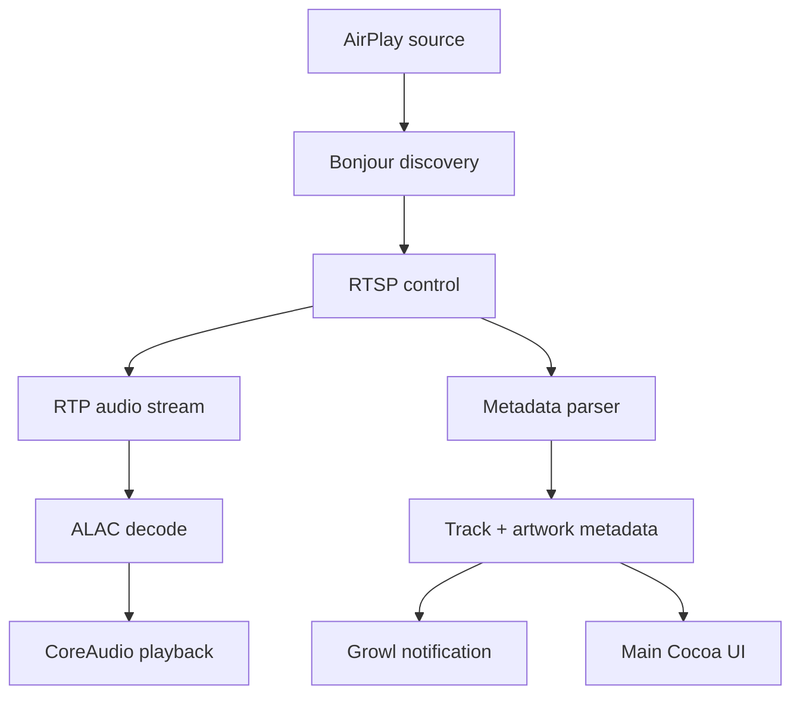

# PowerPlay

> This project was vibecoded with the help of Copilot.

[](https://github.com/pk2061/PowerPlay)
[](https://github.com/pk2061/PowerPlay)
[](https://github.com/pk2061/PowerPlay)

PowerPlay is an experimental classic RAOP/AirPlay receiver prototype for Mac OS X 10.4 Tiger, written in non-ARC Objective-C. It publishes a Bonjour `_raop._tcp` service, accepts incoming RTSP connections, answers Apple-Challenge requests, and has early session and audio-processing scaffolding. Complete streaming from a real sender has not yet been verified.

This project is intentionally a protocol-oriented foundation and research scaffold rather than a turnkey streaming product. It aims to stay faithful to Tiger-era runtime and ABI constraints while modeling the key protocol boundaries required for real AirPlay compatibility.

## Why this project exists

- Mac OS X Tiger does not ship with a public AirPlay receiver API.
- A real implementation needs the RAOP/AirTunes protocol stack: Bonjour discovery, RTSP negotiation, RTP audio, session setup, metadata parsing, and audio playback.
- This repository documents and implements the architecture in a way that is easier to reason about, extend, and validate on legacy systems.

## Current status

PowerPlay is in an experimental, partially implemented state.

### Verified
- The app launches and displays its main window on the target iMac.
- The iMac publishes `000393656C4E@PowerPlay` as `_raop._tcp`; the service has also been visible in a MacBook `dns-sd -B` scan.
- The iMac accepts incoming RTSP TCP connections and has answered `OPTIONS` with `200 OK` and a matching `CSeq`.
- The Apple-Challenge response was exercised locally with the iPhone-style sample challenge. Its RSA signature was independently verified against the challenge, local IPv4 address, and advertised device ID.
- The local Objective-C syntax check and Xcode project-file lint pass. A Tiger/Xcode 2.5 build is not available in the development environment.

### Implemented but not yet verified with a real sender
- Basic RTSP handling for `OPTIONS`, `ANNOUNCE`, `SETUP`, `RECORD`, `PAUSE`, and `TEARDOWN`.
- UDP port binding and response transport fields during `SETUP`.
- Metadata parsing, ALAC-related code, and CoreAudio output scaffolding.

### Not complete
- A successful real-iPhone negotiation through `ANNOUNCE`, `SETUP`, and `RECORD` after the Apple-Challenge response was added.
- Sustained RTP audio reception, sender-compatible ALAC decoding, synchronization, or audible end-to-end playback.
- Reliable handling of timing/control UDP traffic and complete RTSP/authentication edge cases.

The current RTP read path receives at most one packet per read call, and the ALAC decoder is not yet a sender-compatible production decoder. Bonjour visibility and a successful `OPTIONS` exchange therefore do not demonstrate audio playback.

The code is designed as a realistic foundation for further implementation rather than a final consumer-ready application.

## Project layout

- App/ — app lifecycle, UI wiring, and Growl integration
- Audio/ — ALAC decoder and CoreAudio output path
- Network/ — RAOP/RTSP/RTP receiver logic
- Metadata/ — track and cover-art metadata parsing
- UI/ — Cocoa UI and cover-art view
- Resources/ — app resources and localization
- Project/ — Tiger-era Xcode metadata, the bundled `RAOPPrivateKey.pem`, third-party notices, and project setup notes

## Architectural flow

The diagram below shows the intended end-to-end pipeline; several transport and decoder stages remain incomplete.



## Features

- Legacy Cocoa app skeleton for Tiger
- Bonjour `_raop._tcp` service publication
- Incoming RTSP connection handling, including Apple-Challenge responses
- Initial RTSP session and UDP transport setup
- RTP validation, ALAC decoder boundary, and CoreAudio output scaffolding
- Metadata parsing for title, artist, album, and artwork
- Growl notifications on track changes
- Project structure aligned with a classic Xcode Tiger workflow

## Build and validation

This project is set up with a Tiger-oriented syntax validation flow. A lightweight build helper is available at [Project/build.sh](Project/build.sh).

```bash
cd /Users/jan/airplay_tiger_receiver
./Project/build.sh
```

The script is intended for local syntax validation and compatibility checks in a legacy Objective-C/Cocoa build environment.

The latest local checks include the project-wide Objective-C syntax check and `plutil -lint` for both Xcode projects. A local RTSP test exercised `OPTIONS`, `ANNOUNCE`, `SETUP`, `RECORD`, and `TEARDOWN`; this is a protocol smoke test, not proof of interoperability. The Apple-Challenge signature was independently verified locally. The actual Tiger/Xcode 2.5 build and the next iPhone-on-Tiger challenge test are still required.

## Shairport Sync Reference

The classic RAOP Apple-Challenge behavior was implemented in PowerPlay using the reference flow in [rtsp.c](https://github.com/mikebrady/shairport-sync/blob/master/rtsp.c): decode the challenge, append the receiver's local address and six-byte device ID, apply raw RSA PKCS#1 v1.5 signing, and return the unpadded Base64 signature as `Apple-Response`. PowerPlay's handler was written for this project; no Shairport Sync RTSP source function was copied verbatim. The shared classic RAOP RSA key bundled at [Project/RAOPPrivateKey.pem](Project/RAOPPrivateKey.pem) is sourced from [common.c](https://github.com/mikebrady/shairport-sync/blob/master/common.c) in [Shairport Sync](https://github.com/mikebrady/shairport-sync). Its MIT license and attribution are recorded in [Project/THIRD_PARTY_NOTICES.md](Project/THIRD_PARTY_NOTICES.md).

## GitHub release checklist

See [RELEASE_CHECKLIST.md](RELEASE_CHECKLIST.md) for the release checklist used to validate the app before shipping prototypes or tagged builds.

## Notes

This repository is a practical starting point for a Tiger-era AirPlay receiver, not a complete drop-in implementation. It is best viewed as a protocol-first engineering prototype; real iPhone session negotiation and audio playback remain open validation milestones.
