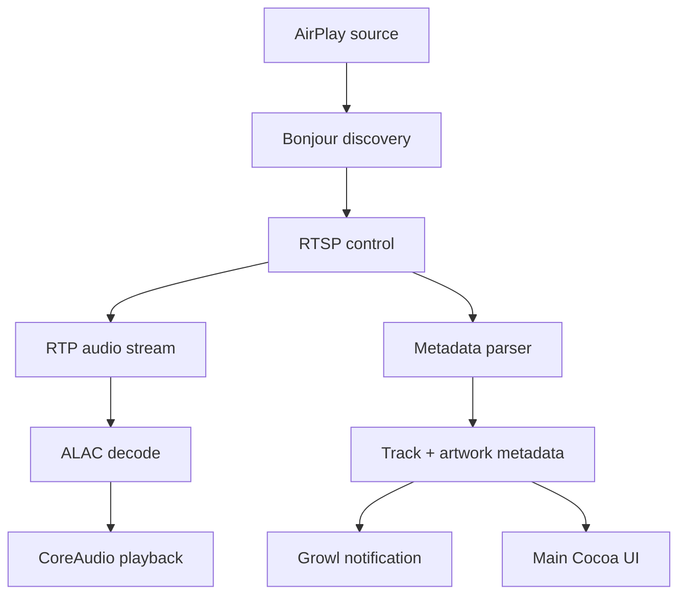

# PowerPlay

> This project was vibecoded with the help of Copilot.

[](https://github.com/pk2061/PowerPlay)
[](https://github.com/pk2061/PowerPlay)
[](https://github.com/pk2061/PowerPlay)

PowerPlay is an experimental classic RAOP/AirPlay audio receiver for Mac OS X 10.4 Tiger, written in non-ARC Objective-C. It advertises via Bonjour, receives audio from an AirPlay sender, and plays it through CoreAudio. Audible playback from an iPhone has been tested on a Tiger iMac.

The project remains a prototype rather than a turnkey streaming product. It aims to stay compatible with Tiger-era runtimes and toolchains while implementing the classic RAOP protocol.

## Why this project exists

- Mac OS X Tiger does not ship with a public AirPlay receiver API.
- A real implementation needs the RAOP/AirTunes protocol stack: Bonjour discovery, RTSP negotiation, RTP audio, session setup, metadata parsing, and audio playback.
- This repository documents and implements the architecture in a way that is easier to reason about, extend, and validate on legacy systems.

## Current status

PowerPlay is experimental and has been tested with an iPhone and a Tiger iMac. Other senders, system configurations, and long-running use need further testing.

### Verified
- The app launches on the target iMac and publishes a Bonjour `_raop._tcp` service.
- An iPhone has connected through RTSP negotiation and streamed audible audio on Tiger. A longer run decoded more than 8,000 RTP packets before teardown.
- The audio path has exercised Apple-Challenge, AES key negotiation, RTP reception and decryption, NTP timing exchange, Apple Lossless decoding, and CoreAudio output.
- Disconnecting the iPhone returns the app to its waiting state. The user reports that playback timing across pause and resume has improved, though it still needs further validation.
- Long track, artist, and album labels scroll successfully on Tiger.

### Implemented
- Classic RAOP RTSP session handling and UDP audio, control, and timing sockets.
- Track title, artist, album, and cover-art display; optional Growl notifications; and sender volume mapping.
- Playback progress with elapsed, total, and remaining time, including RTP-silence-based pause detection when the sender does not send `PAUSE`.
- Horizontally scrolling track, artist, and album labels when text overflows.

### Limitations
- Playback timing is an estimate based on sender progress and audio activity. Duration may be unavailable, and a prolonged network interruption can be mistaken for a pause.
- Sender names depend on an advertised client name or a resolvable hostname; otherwise the UI uses a generic name.
- Playback controls and protocol edge cases, synchronization, and compatibility across senders require further testing. AirPlay 2 support is not claimed.
- Tiger/Xcode 2.5 builds and runtime behavior must be checked on the target machine; modern host syntax checks cannot establish Tiger compatibility.

## Project layout

- App/ — app lifecycle, UI wiring, and Growl integration
- Audio/ — ALAC decoder and CoreAudio output path
- Network/ — RAOP/RTSP/RTP receiver logic
- Metadata/ — track and cover-art metadata parsing
- UI/ — Cocoa UI and cover-art view
- Resources/ — app resources and localization
- Project/ — Tiger-era Xcode metadata, the bundled `RAOPPrivateKey.pem`, third-party notices, and project setup notes

## Architectural flow

The diagram below shows the receiver's audio and metadata paths.



## Features

- Cocoa app targeting Tiger
- Bonjour `_raop._tcp` service publication
- Incoming RTSP connection handling, including Apple-Challenge responses
- RTSP session handling, RTP audio reception, AES decryption, Apple Lossless decoding through AudioConverter, and CoreAudio output
- Track metadata, artwork, sender volume, and experimental progress display
- Growl notifications on track changes, with artwork when available and the application icon as a fallback
- Project structure aligned with a classic Xcode Tiger workflow

## Build and validation

For a target build, open [PowerPlayApp.xcodeproj](PowerPlayApp.xcodeproj) on the Tiger machine with Xcode 2.5 and build the PowerPlay target. Test the resulting app with an AirPlay sender on the same network.

A lightweight host syntax check is available at [Project/build.sh](Project/build.sh):

```bash
./Project/build.sh
```

Run the command from the repository root on a Mac with the required development tools and frameworks. It checks Objective-C syntax with the host SDK; it does not produce an app or verify Tiger SDK, linking, or runtime compatibility.

The project-wide host syntax check has passed with modern SDK deprecation warnings. Both Xcode project files have previously passed `plutil -lint`. A Tiger build and iPhone test are still needed after changes, particularly for timing edge cases.

Growl notifications use the legacy distributed notification protocol and do not require linking Growl.framework. Install and run a Tiger-compatible version of Growl to display them. The host-side notification payload test can be run with:

```bash
clang -fno-objc-arc -IApp -framework Cocoa Tests/GrowlNotifierTests.m App/GrowlNotifier.m -o /tmp/powerplay-growl-notifier-tests
/tmp/powerplay-growl-notifier-tests
clang -fno-objc-arc -Wno-incomplete-implementation -IApp -IAudio -INetwork -IMetadata -IUI -framework Cocoa Tests/GrowlTrackFlowTests.m App/AirPlayReceiverAppDelegate.m UI/CoverArtView.m -o /tmp/powerplay-growl-track-flow-tests
/tmp/powerplay-growl-track-flow-tests
```

Actual notification delivery, artwork, and Growl preferences still require validation on Tiger with Growl running.

## Shairport Sync Reference

[Shairport Sync](https://github.com/mikebrady/shairport-sync) is a reference for classic RAOP protocol behavior. Its [rtsp.c](https://github.com/mikebrady/shairport-sync/blob/master/rtsp.c) informed PowerPlay's Apple-Challenge response, `X-Apple-Client-Name` handling, and interpretation of `progress` RTP timestamps. PowerPlay's RTSP handler was written for this project; no Shairport Sync RTSP source function was copied verbatim.

PowerPlay's Apple-Challenge response signs the challenge together with the local address and six-byte device identifier using RSA PKCS#1 v1.5, then returns the unpadded Base64 signature. The bundled classic RAOP private key in [Project/RAOPPrivateKey.pem](Project/RAOPPrivateKey.pem) comes from Shairport Sync's [common.c](https://github.com/mikebrady/shairport-sync/blob/master/common.c). Attribution and the MIT license are recorded in [Project/THIRD_PARTY_NOTICES.md](Project/THIRD_PARTY_NOTICES.md).

## GitHub release checklist

See [RELEASE_CHECKLIST.md](RELEASE_CHECKLIST.md) for the release checklist used to validate the app before shipping prototypes or tagged builds.

## Notes

PowerPlay is a working prototype, not a complete drop-in AirPlay implementation. See [RELEASE_CHECKLIST.md](RELEASE_CHECKLIST.md) for outstanding release validation.
